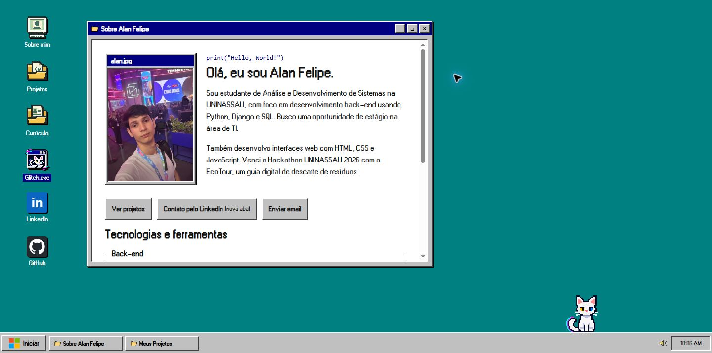

# Alan.dev — Portfólio

Um portfólio pessoal que transforma a navegação em uma área de trabalho inspirada no Windows 95. O projeto reúne minha trajetória, habilidades e projetos em uma interface interativa, desenvolvida com HTML, CSS e JavaScript puro.

**[Acessar o portfólio](https://alan-felipe-portfolio.vercel.app)**



## Explore a área de trabalho

- **Sobre mim:** apresentação, formação e tecnologias que estudo.
- **Projetos:** trabalhos e estudos com suas tecnologias e links para código ou demonstração.
- **Glitch.exe:** um gato que acompanha a área de trabalho. É possível interagir com ele, pausar ou ocultá-lo e escolher se inicia com o site.
- **Campo Minado:** jogo acessível pelo menu Iniciar, com cronômetro e modo de bandeira para telas de toque.
- **Painel de Controle:** alterna entre os temas Padrão, Noite e Órbita 95.
- **Janelas:** podem ser arrastadas, minimizadas, maximizadas, restauradas e fechadas. A barra de tarefas permite alternar entre elas.
- **Atalhos:** acesso ao GitHub, LinkedIn e contato por e-mail.

A interface se adapta a telas menores e à navegação por toque. A janela de currículo já existe, mas seu conteúdo ainda está em preparação.

## Projetos apresentados

| Projeto | Descrição | Links |
| --- | --- | --- |
| **EcoTour** | Guia digital de descarte de resíduos, vencedor do Hackathon UNINASSAU 2026. | [Código](https://github.com/alanfelipe01/EcoTour) |
| **Litorânea Ambiental** | Landing page para a empresa júnior de Ciências Ambientais da UFC. | [Site](https://litoranea-ambiental-ufc.vercel.app/) · [Código](https://github.com/alanfelipe01/litoranea-ambiental) |
| **Portfolio-Web** | Este portfólio, com área de trabalho e janelas interativas. | [Código](https://github.com/alanfelipe01/Portfolio-Web) |
| **Python — Estudos e Exercícios** | Exercícios, desafios e projetos para praticar Python e lógica de programação. | [Repositório](https://github.com/alanfelipe01/python-estudos) |

## Tecnologias

- HTML5, CSS3 e JavaScript
- Vercel para hospedagem

O projeto não utiliza frameworks, instalação de dependências ou etapa de build.

## Executar localmente

```bash
git clone https://github.com/alanfelipe01/Portfolio-Web.git
cd Portfolio-Web
```

Abra o arquivo `index.html` no navegador ou utilize um servidor local, como o Live Server do VS Code.

## Como navegar

Clique ou toque nos ícones da área de trabalho para abrir janelas e acessar links. Arraste uma janela pela barra de título; use os botões no canto superior para minimizar, maximizar ou fechar. Os botões na barra de tarefas permitem alternar entre as janelas.

No menu Iniciar, use **Tab**, as **setas**, **Home** e **End** para navegar e **Esc** para fechar. No Campo Minado, use o botão direito ou a tecla **F** para marcar uma bandeira; em telas de toque, ative o modo de bandeira.

O navegador pode guardar localmente o tema, a preferência de inicialização do Glitch, a apresentação da primeira visita e o melhor tempo do jogo. Se o armazenamento estiver indisponível, algumas preferências podem não persistir. O relógio tem valor fixo e o ícone de som é decorativo.

## Estrutura do projeto

```text
Portfolio-Web/
├── index.html       # Área de trabalho e janelas
├── css/             # Estilos separados por componente e responsividade
├── js/              # Interações, temas, Glitch e Campo Minado
├── assets/
│   ├── fonts/       # Fonte da interface
│   ├── glitch/      # Imagens do mascote
│   ├── icons/       # Ícones do portfólio e tecnologias
│   └── images/      # Foto e captura do portfólio
└── README.md
```

## Próximos passos

O portfólio continua em desenvolvimento. Entre as ideias em planejamento estão aprofundar a apresentação dos projetos e criar um navegador simulado dentro da área de trabalho.

## Sobre mim

Sou Alan Felipe, estudante de Análise e Desenvolvimento de Sistemas na UNINASSAU, com foco em desenvolvimento back-end com Python, Django e SQL. Busco uma oportunidade de estágio na área de TI.

- [GitHub](https://github.com/alanfelipe01)
- [LinkedIn](https://www.linkedin.com/in/alan-felipe-621a72406/)

## Inspiração

A ideia surgiu após conhecer um portfólio com uma proposta semelhante em uma publicação no Reddit. A partir dela, comecei a criar minha própria versão, experimentando ideias e aprendendo durante o processo.

[Publicação que inspirou o projeto](https://www.reddit.com/r/webdev/comments/r8qia3/i_modelled_my_portfolio_website_after_windows_95/)
